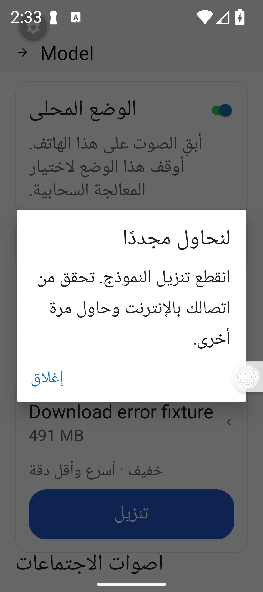
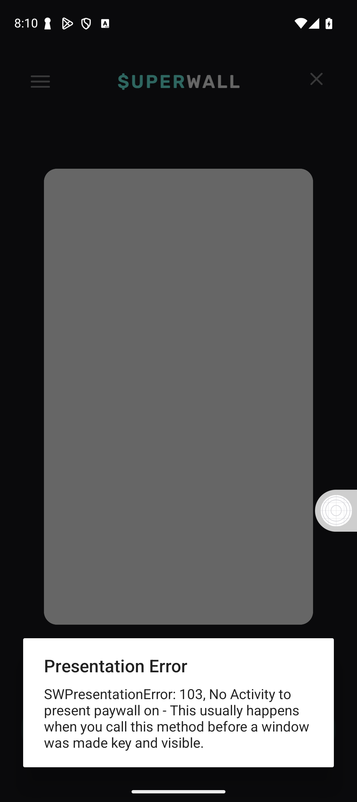

# Android acceptance checkpoint — 27 October 2026

This is partial acceptance evidence for draft PR 2684. It does not approve a release.

## Installed candidate

Version 1.2.6, Android version code 29, was built from `40abcfe98d0ac95e8930cd52e0c7d502206e3fe1` and installed through Google Play's private internal track. The app was updated without uninstalling or clearing its data. Testing used an emulator and synthetic accounts.

- Upgrading retained three notes with their exact original text, three dictionary words, two snippets, the account's 8-word/1-dictation totals, and five downloaded models.
- Revoking the owned native session exposed a reachable sign-in action. Signing in again recovered the same account and its local work without restarting the app. A generic invalid-session alert appeared before the inline recovery state.
- A → Local → B → Local → A retained separate totals (8/1, 12/1, 0/0). A saved, unanswered Chat fixture appeared only under A and returned when A signed in again. The temporary chat was deleted after verification. Notes, dictionary and snippets remained isolated and returned under A.
- A cold restart after the preview window closed retained A and its 8/1 totals. This checks local identity retention while the preview is protected, not fresh server authentication.
- Expired Restore reported no active Google Play purchase and preserved existing access. No new checkout was accepted during this window.
- Provider key replacement/removal and restart, provider fields with a full keyboard at 100%/200% text, Arabic 401/429/500 errors and retry, and cancellation when leaving the note editor passed within the recorded fixture scope.
- Eight TalkBack cases covered the center of Words/Snippets Add controls in English/Arabic at 100%/200% text. These are bounded focus/activation checks, not a complete screen-reader audit.
- Actual model download network loss displayed an Arabic recovery message; retry reached Ready. Explicit cancellation was classified separately. The disposable model was removed, retaining the five original models and selections.

Cloud backup and statistics sync remained off, usage analytics remained on, history remained Forever, Local Mode remained on, and text cleanup remained off. The approved preview window is closed and its temporary firewall rule removed. Emulator font, locale, keyboard, accessibility and DHCP settings were restored.

## Repairs after code29

Commit `ababc3aa60dea8952a0f28735bc75f18b1f58417` fixes two issues found during those checks:

1. Removing a custom server key now enables an explicit Save without requiring another field to change. Removal alone does not save an anonymous configuration. The Save button also retains its translated accessible name after processing finishes.
2. Model operation errors use the translated Close action instead of Android's default English OK button.

The focused suites passed 153 tests; TypeScript, formatting and scoped lint passed with nine existing warnings. The screenshots below show the changed components in Expo Go with Arabic text at 200% size, synthetic in-memory configuration/key storage, and a simulated model failure. No provider or model network request was sent. These repairs have not been built into or tested in the installed Play app.

Main through `9ce28e8fc` was then merged into the draft branch as `35404bfb089f08e52c992a343ec91d4b2151e21a`. The single test conflict retained both incomplete-transcript recovery coverage and main's new editable notes beside an uploaded transcript. The combined source passed all 358 mobile suites / 4,614 tests and TypeScript. An initial test invocation from the repository root had two module-resolution setup failures; both passed from the mobile working directory, followed by the complete passing run. No test or dependency configuration was changed to obtain that result.

### Save after removing the key

Save is enabled after confirmed removal, with the endpoint and model unchanged. Tapping it shows the translated Saved message and leaves a disabled button still named Save to accessibility services.

### Localized model error

The complete error and Arabic Close action remain readable at 200% text size. Close dismisses the dialog and returns to the download control.

## Native Superwall preview repair

The installed code29 app reached the SDK's native picker for the inactive Android
paywall draft. Presenting it returned error 103, including after a clean restart.
The screenshot below is the installed failure, not a repaired-app preview.

The Android-only Expo bridge patch now follows Superwall's native foreground
activity tracker, retaining Expo's activity as an initial-startup fallback. This
addresses the stopped React activity being selected while the SDK preview is in
front. No purchase-controller, product, identity or SDK/Billing version change is
included.

A focused JVM regression fails against the original bridge and passes with the
patch. It covers startup, native preview, older-activity destruction,
backgrounding, resume, preview destruction and returning to React. The actual
provider is compiled with checksum-pinned SDK 2.8.3 tracker source and lightweight
Android/Expo lifecycle stubs. The patch also compiles against the released SDK
2.8.3 AAR and reapplies through patch-package to the integrity-verified npm package.
Six adjacent billing/Superwall suites pass 98 tests. These checks do **not** prove
native presentation, font scaling, locale propagation, TalkBack or purchases in
the installed app; the repair is not in code29.

Reproduction and limits: [native presenter probe](../../../openwhispr-mobile/scripts/android-superwall-activity/README.md).

## Authentication dependency readiness

The next hosted run failed its mobile dependency audit on newly reported Better
Auth advisories, before installation or bundling. The mobile client now pins
`better-auth`, `@better-auth/expo` and the core override to `1.7.14`. The audit
configuration and its existing exceptions are unchanged. This changes the app's
client dependencies; it does not deploy or migrate an authentication server.

The Expo client now reads cookies asynchronously. The app awaits those reads,
accepts both OpenWhispr and preview cookie prefixes, and clears sessions through
the SDK's storage adapter so pending writes and chunked values are handled
together. Regression controls reproduced unresolved cookie values, ignored
OpenWhispr cookies and a pending write restoring a cleared cookie before the
repairs.

All 358 mobile suites / 4,616 tests pass, including 31 actual-SDK host scenarios
for sign-in, signup, anonymous sessions, cached identity, rejection, cookie
prefixes and storage cleanup. Native storage and HTTP are substituted in that
harness. TypeScript, scoped lint/formatting, 11 dependency-security tests, the
lockfile checks, the configured security audit and Android/iOS JavaScript exports
pass. This evidence does not replace installed upgrade, sign-in or account
acceptance; code29 still contains the earlier dependencies.

Upstream references: [security advisory](https://github.com/advisories/GHSA-965c-763c-88jm)
and [Expo client migration notes](https://github.com/better-auth/better-auth/blob/v1.7.14/packages/expo/CHANGELOG.md).

## Remaining acceptance

The full gate still includes installed acceptance of the newest source, billing failure/delay/retry and entitlement ownership, actual signed Superwall delivery with isolated sandbox routing, native statistics consent/queue ordering, real spoken dictation and Cloud/Local meetings with interruptions, remaining accessibility and storage/corruption cases, native analytics opt-out, and accepted local cleanup quality. Physical phones in the required 3–4 GB, 6 GB and 8+ GB classes are tested last and remain mandatory before launch.

Historical code24 data loss has not been recovered. Passing the current preservation fixtures does not recover those nine lost notes. The inactive paywall draft, production provider configuration, product merge and public rollout remain separate from these tests.
